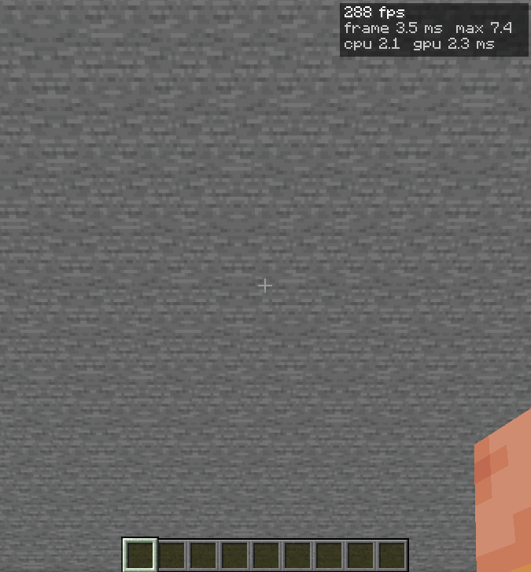

# PR #8941 current-main benchmark

Paired release-build comparison captured 2026-11-04. This supersedes the older launcher-nightly comparison for current-main claims.

## Builds and environment

- PR head: `3ec390a6b8b56db316e759bcd332c26a2160d600` (`fix/pr8941-review`).
- Main baseline: `f40d4df781963ed0a6e1e0fd41bf740f652e2e46` (`origin/main`).
- Both binaries use the `release` profile. Main was built from a detached worktree with `cargo build --release -p horizon-client -j 2`; no `-j 8` was used.
- Test host: Intel Core i7-3770S (4 cores / 8 threads, 3.1 GHz base), 8 GiB RAM (7.5 GiB available to Linux), Intel HD Graphics 4000 (IVB GT2, 1.5 GiB shared video memory), Mesa 26.2.4. OpenGL, offscreen 1280×720, render distance 8. CPU frequency scaling is enabled (1.6–3.9 GHz), and this desktop was not isolated from background work. Treat short-run deltas as noisy; a stronger machine should independently repeat the comparison.
- FPS overlay enabled; entity-culling precheck set to 64 on the PR build.
- PR binary SHA-256: `175d02dcf0fc752ce4704ce3b6b0949f4ccc311d546e6b432c0a8915a7be19fa`.
- Main binary SHA-256: `52c3ac0fbc75a481221de94e1825331e468c63a7b637eebea3b2a3dd5fa40081`.
- Each cell is one 2-second sample after the scene is loaded. This is a short single-run comparison; small deltas are within likely run-to-run variation.
- The stationary scene uses identical start/end camera coordinates for the full sample. The moving scenes use the same short flight path on both builds.
- CPU is the benchmark harness CPU average per frame; FPS is measured across the timed scene. The screenshot FPS overlay is an instantaneous display, not the table average.

## Results

FPS delta and CPU delta compare PR head with current main. Positive CPU delta means the PR used more CPU.

### Off

| Scene | Main FPS / CPU ms | PR FPS / CPU ms | FPS Δ | CPU Δ |
|---|---:|---:|---:|---:|
| entity_normal | 231.7 / 0.814 | 229.6 / 0.864 | -0.9% | +6.1% |
| entity_wall | 228.3 / 1.361 | 223.5 / 1.410 | -2.1% | +3.6% |
| entity_wall_slit | 214.2 / 1.522 | 219.8 / 1.428 | +2.6% | -6.2% |
| entity_stress | 187.4 / 2.513 | 186.8 / 2.626 | -0.3% | +4.5% |
| entity_stress_slit | 185.1 / 2.567 | 185.2 / 2.589 | +0.1% | +0.9% |
| entity_stationary_512 | 185.7 / 2.562 | 187.6 / 2.553 | +1.1% | -0.3% |

### Sync

| Scene | Main FPS / CPU ms | PR FPS / CPU ms | FPS Δ | CPU Δ |
|---|---:|---:|---:|---:|
| entity_normal | 227.8 / 0.909 | 233.5 / 0.862 | +2.5% | -5.1% |
| entity_wall | 320.3 / 1.230 | 320.2 / 1.360 | -0.0% | +10.6% |
| entity_wall_slit | 258.7 / 1.497 | 261.8 / 1.520 | +1.2% | +1.5% |
| entity_stress | 314.0 / 2.502 | 315.7 / 2.580 | +0.5% | +3.1% |
| entity_stress_slit | 263.2 / 2.567 | 249.6 / 2.845 | -5.2% | +10.8% |
| entity_stationary_512 | 315.2 / 2.467 | 303.0 / 2.714 | -3.9% | +10.0% |

### Async

| Scene | Main FPS / CPU ms | PR FPS / CPU ms | FPS Δ | CPU Δ |
|---|---:|---:|---:|---:|
| entity_normal | 232.7 / 0.830 | 232.0 / 0.830 | -0.3% | +0.0% |
| entity_wall | 224.1 / 1.483 | 229.0 / 1.491 | +2.2% | +0.5% |
| entity_wall_slit | 219.5 / 1.466 | 224.6 / 1.499 | +2.3% | +2.3% |
| entity_stress | 186.2 / 2.668 | 186.9 / 2.899 | +0.4% | +8.6% |
| entity_stress_slit | 184.3 / 2.672 | 186.1 / 2.871 | +1.0% | +7.4% |
| entity_stationary_512 | 300.1 / 2.146 | 302.6 / 0.985 | +0.8% | -54.1% |

## Async observations

- Moving camera: the PR build recorded zero applied pre-model culls in all five moving scenes. Worker-hidden results were rejected as stale when the camera changed; the path fails open. CPU was +0.0% in the 24-mob normal scene, +0.5% / +2.3% in the 192-mob wall/slit scenes, and +8.6% / +7.4% in the 512-mob wall/slit scenes. FPS stayed within +0.4% to +2.3% of main.
- Stationary 512-pig wall: PR Async recorded 269,818 pre-model culls, 269,818 AABB cache hits, 12 misses, one worker job, and no stale-camera jobs. CPU average fell from 2.146 ms to 0.985 ms (-54.1%); FPS changed from 300.1 to 302.6 (+0.8%). This is CPU headroom, not a meaningful FPS increase in this sample.
- The exact-camera safety fix is therefore visible in the counters: moving-camera results fail open; same-camera proofs are reused.

## Screenshots

The moving-scene screenshot is the scene setup immediately before its timed camera flight. The stationary screenshot is from the fixed-camera scene. Both show the in-game performance overlay.

### Moving 512-pig wall setup

### Fixed-camera 512-pig wall

## Reproduction driver

`driver/entity_occlusion_main_bench.py` wraps the repository `tools/perf_bench.py` and `tools/stress_scenes.py` harnesses for the six scene matrix, including the zero-motion stationary case. Set `HORIZON_REPO_ROOT` to a checkout containing those tools and `HORIZON_BENCH_ARTIFACTS` to a directory with `current-head/horizon-client` and `main-f40d4df/horizon-client`, then run the script from that checkout. The full per-run harness output and culling counters are in `results.json`.
