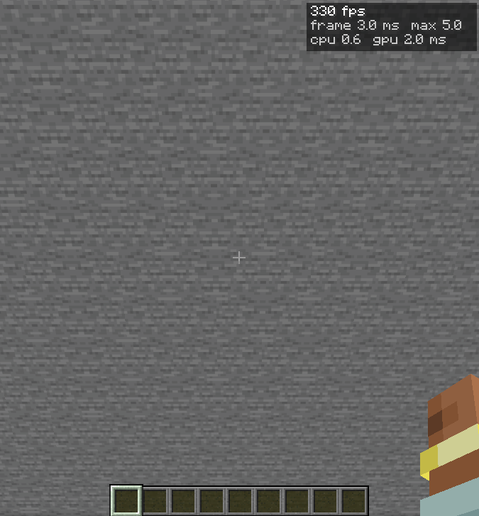
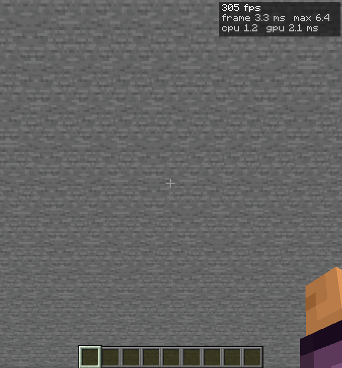
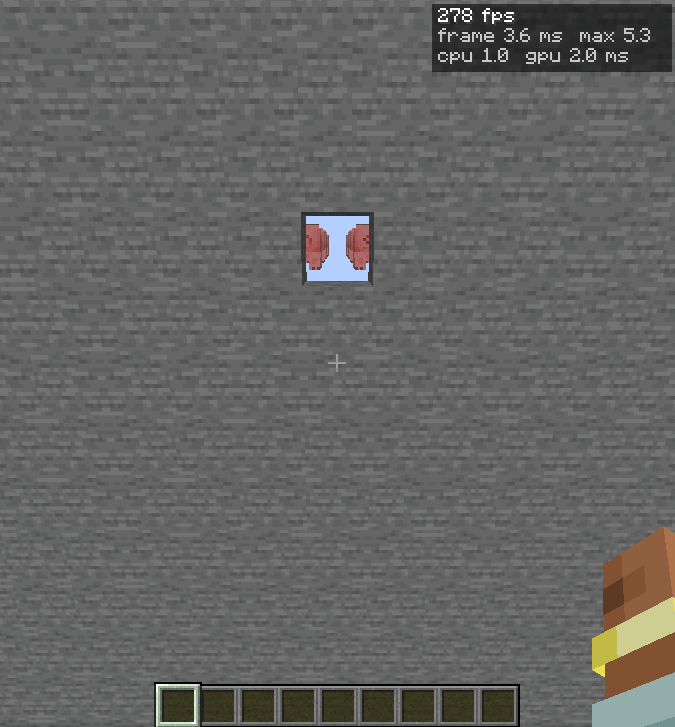
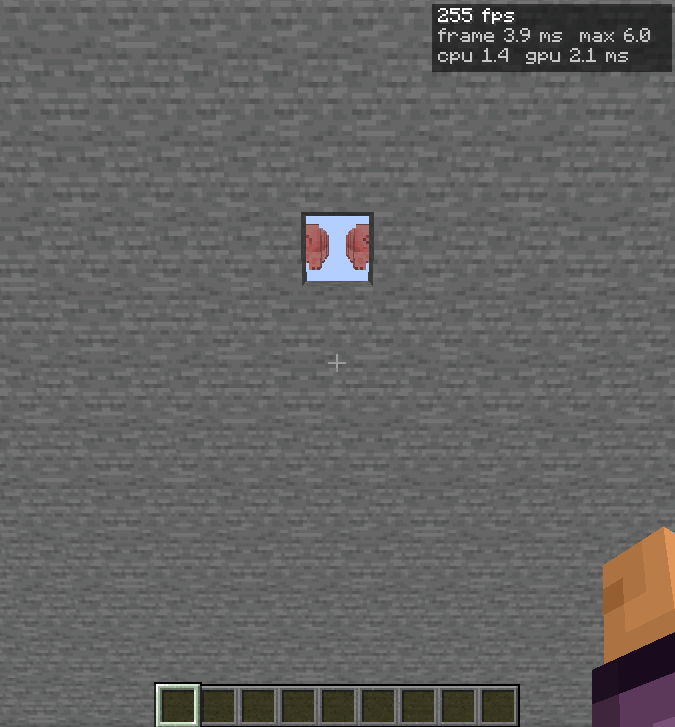

# PR #8941 quick entity-culling comparison

This compares the **pre-review-fix release-profile client** copied from `target/release` with the Horizon Launcher build `nightly-2026-11-04-3fb4c31`. It does **not** benchmark the safety-fix commit currently on PR #8941.

## Method

- `tools/perf_bench.py` with the entity-occlusion scene driver, one 2-second flight per scene and mode.
- OpenGL, offscreen, 1280×720, render distance 8, 0.5-second settle; same generated scene and flight paths for each binary.
- Five scenes: 24 visible mobs; 192 mobs behind a solid wall or one-block slit; 512 mobs behind a solid wall or one-block slit.
- Modes: Off, Sync, Async. Screenshot captures use the FPS performance overlay.
- Hardware: Intel Core i7-3770S, Intel HD Graphics 4000, Mesa OpenGL.
- Single short samples; treat the results as a quick comparison, not a repeatability study.

The pre-fix binary was `Horizon 0.1.0`, copied from `target/release` (built 2026-11-04 03:52 +0330; SHA-256 `7dda8faa28cef66cbcd6614283d23f02b1f0992f1f12d5498cf13dafc968159d`). The launcher nightly identified itself as `nightly-2026-11-04-3fb4c31` (SHA-256 `b4116f33a8398cc62c86502c31a67d4e6c0aaf7889170c72d3157774842754a0`).

## Results

| Mode | Scene | Pre-fix FPS | Nightly FPS | FPS Δ | Pre-fix CPU ms | Nightly CPU ms |
|---|---|---:|---:|---:|---:|---:|
| Off | 24 mobs, normal | 243.9 | 225.3 | +8.3% | 0.771 | 0.889 |
| Off | 192 mobs, solid wall | 227.7 | 219.7 | +3.6% | 1.515 | 1.420 |
| Off | 192 mobs, one-block slit | 232.8 | 216.7 | +7.5% | 1.380 | 1.435 |
| Off | 512 mobs, solid wall | 190.9 | 185.6 | +2.9% | 2.653 | 2.489 |
| Off | 512 mobs, one-block slit | 187.8 | 181.9 | +3.3% | 2.743 | 2.511 |
| Sync | 24 mobs, normal | 236.9 | 227.4 | +4.1% | 0.922 | 0.936 |
| Sync | 192 mobs, solid wall | 333.9 | 308.5 | +8.2% | 1.387 | 1.390 |
| Sync | 192 mobs, one-block slit | 258.6 | 258.3 | +0.2% | 1.650 | 1.442 |
| Sync | 512 mobs, solid wall | 320.9 | 297.7 | +7.8% | 2.655 | 2.720 |
| Sync | 512 mobs, one-block slit | 264.0 | 251.4 | +5.0% | 2.866 | 2.720 |
| Async | 24 mobs, normal | 243.0 | 223.8 | +8.6% | 0.789 | 0.910 |
| Async | 192 mobs, solid wall | 327.4 | 222.1 | +47.4% | 0.586 | 1.455 |
| Async | 192 mobs, one-block slit | 273.7 | 214.3 | +27.7% | 0.958 | 1.649 |
| Async | 512 mobs, solid wall | 322.7 | 185.7 | +73.8% | 0.916 | 2.704 |
| Async | 512 mobs, one-block slit | 263.3 | 183.4 | +43.5% | 1.435 | 2.710 |

The benchmark JSON contains the full per-scene measurements and, where available, the pre-fix build’s async-culling counters. The nightly does not expose the same counters.

## Async screenshots

Solid wall (entities hidden):

One-block slit (visible entities through the opening):

